<h1 align="center">💫 Starfait 💫</h1>

<p align="center">
    <a href="https://discord.gg/2gQR7t3WJR"></a>
    
</p>

Starfait is a re-implementation of GameMaker: Studio's runner (YoYo Runner) in Kotlin, targeting Undertale v1.08 (WAD Version 16).

## Screenshots

### Undertale

<div align="center" class="grid" markdown>
    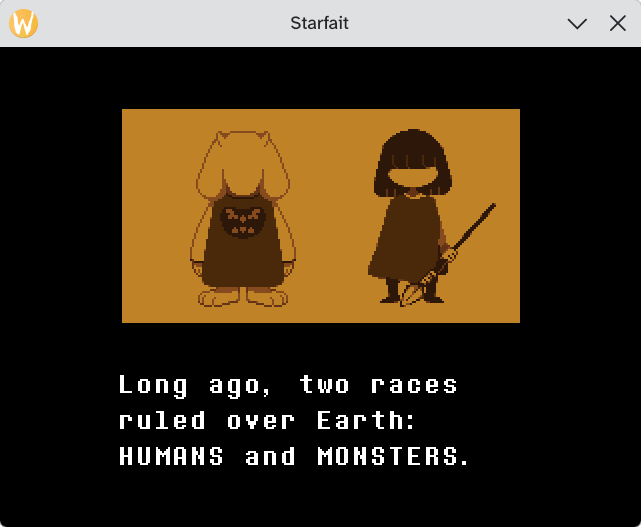
    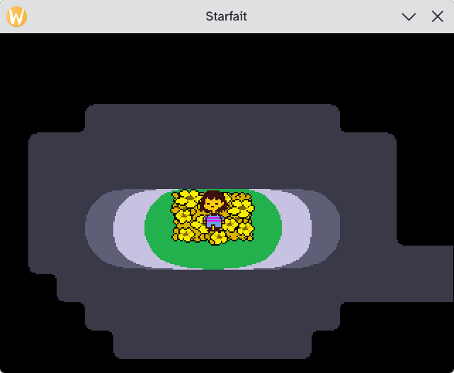
    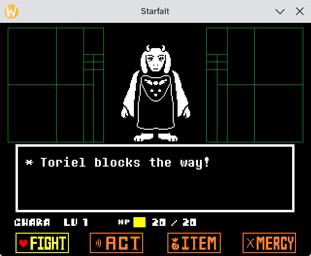
    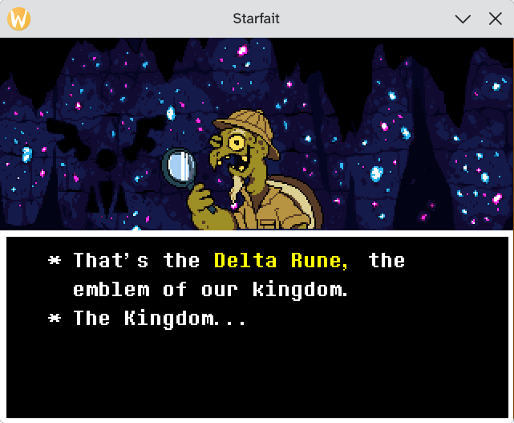
    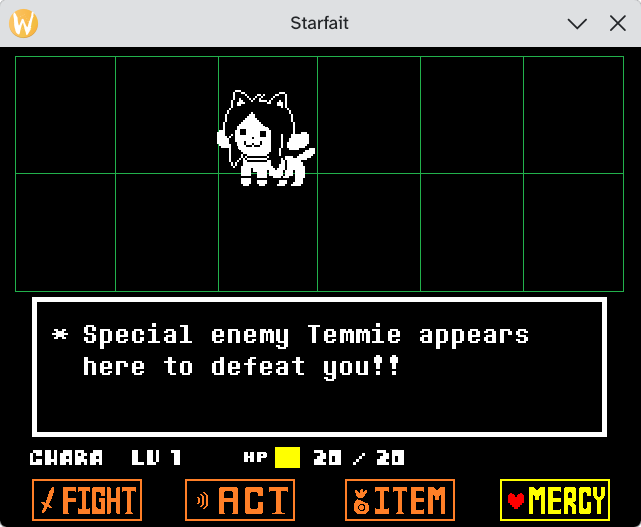
    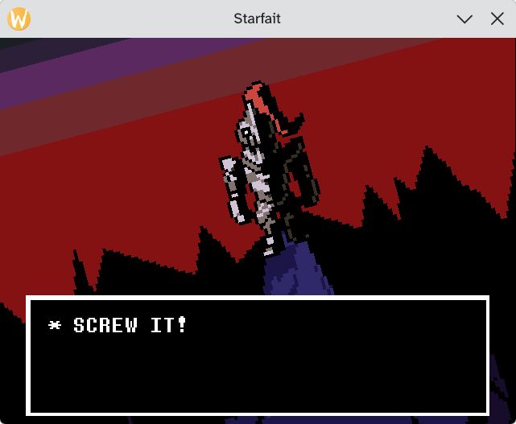
    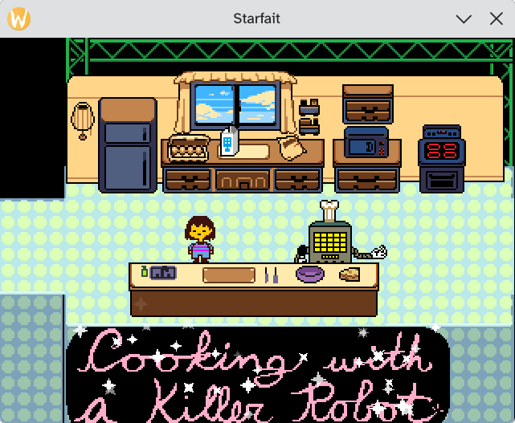
    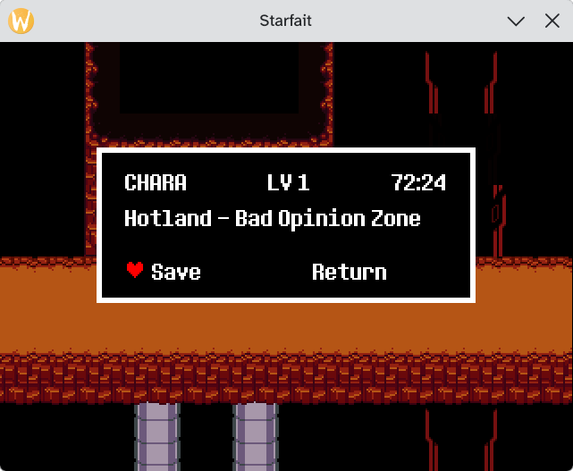
    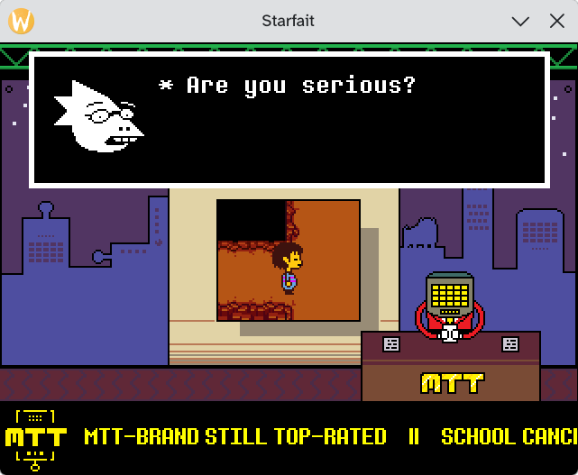
    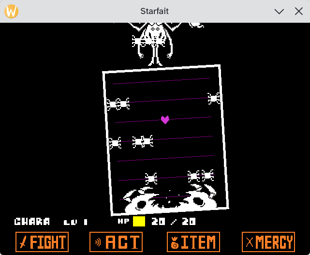
    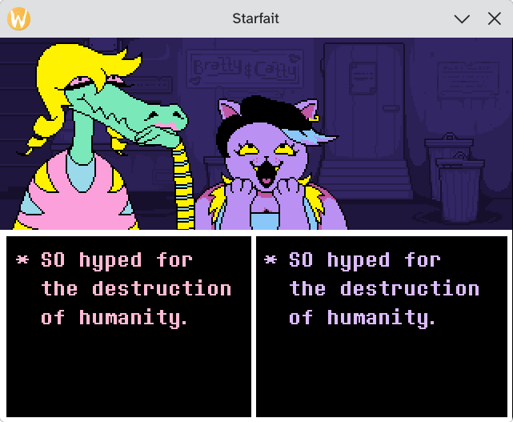
    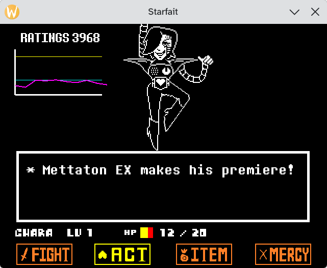
    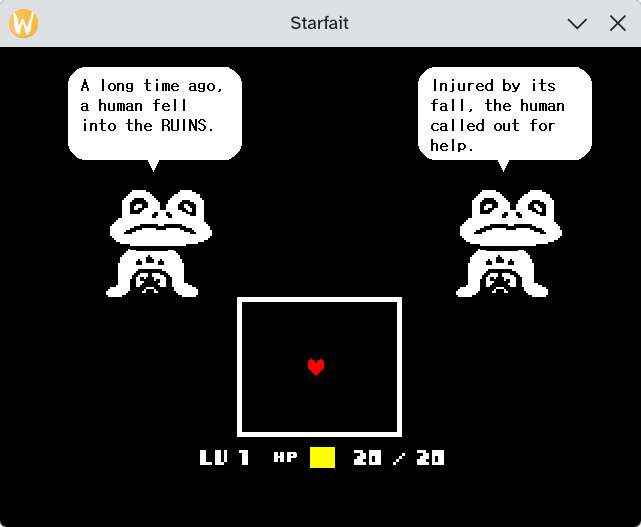
    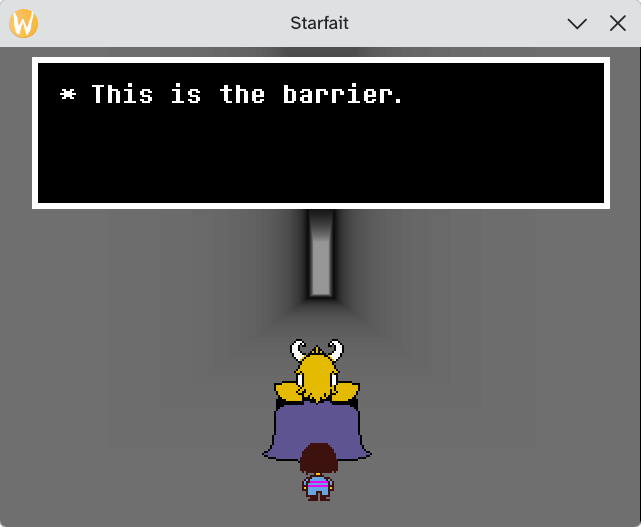
    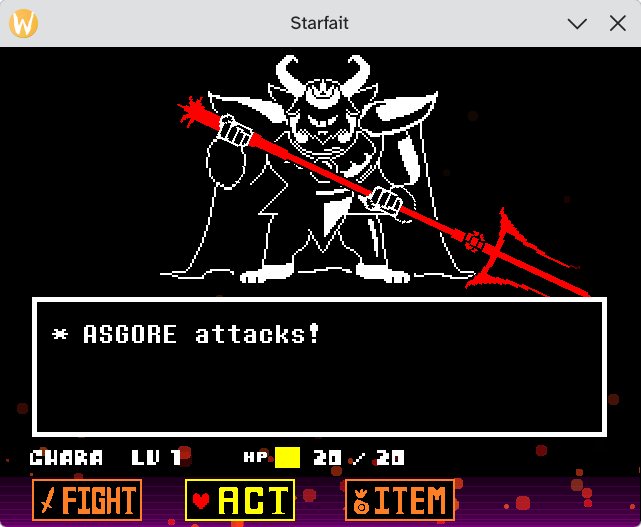
    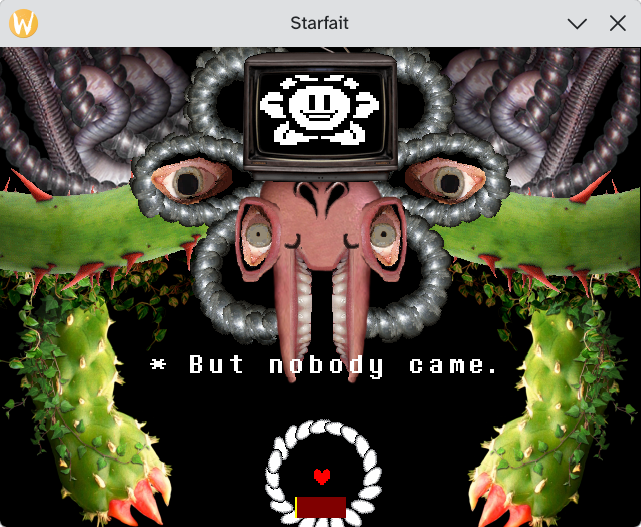
    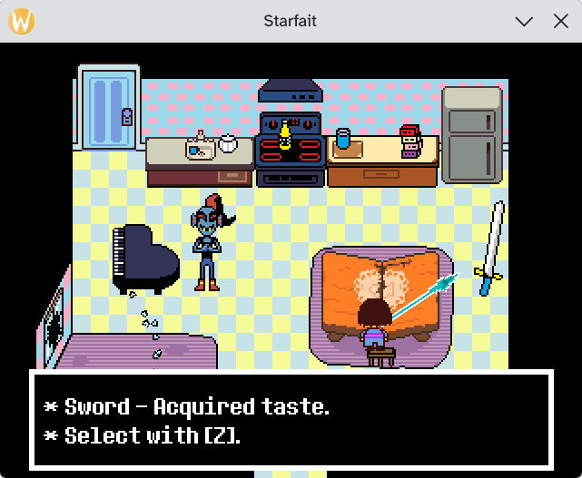
    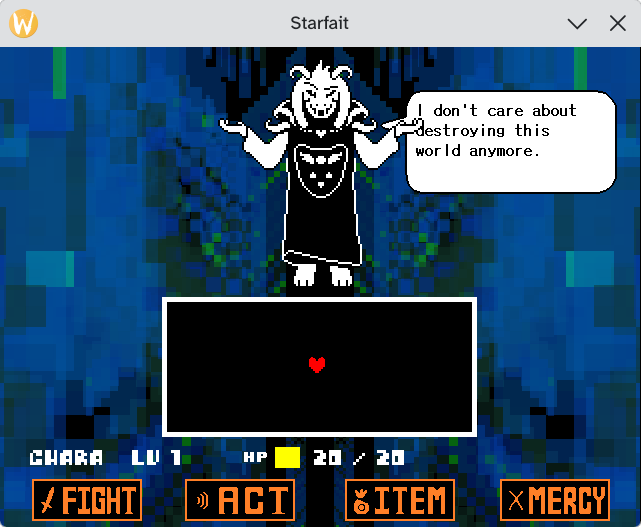
    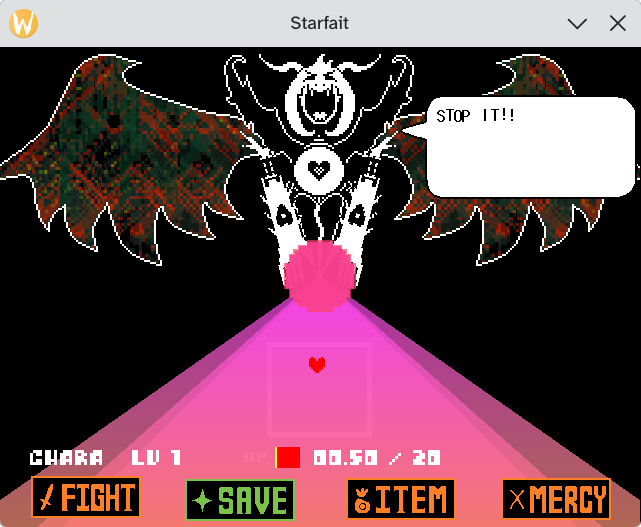
    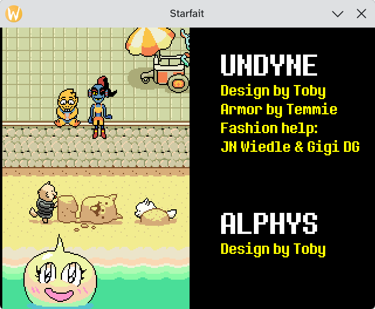
</div>

## Game Compatibility

To keep the project's scope simple, Starfait only supports Undertale v1.08 and NOTHING ELSE. I may add support for DELTARUNE later if I'm feeling fancy.

Undertale's True Pacifist route is playable in Starfait, with some minor graphical glitches due to missing builtins.

By virtue of it being a GameMaker runner re-implementation, other games do work as long as they were built with GM:S 1.4.1773..1.4.9999 and only use the same features and builtins that Undertale uses.

I'm not planning on going out of my way to support any other games, because that's a recipe for burnout. Supporting all games is *hard* because GameMaker has TONS of builtin functions and features. Re-implementing the runner is more akin to Wine or a high-level emulator than to a console emulator.

## Web ports powered by Starfait

* Undertale: https://webtale.mrpowergamerbr.com/

## Downloads

> [!WARNING]  
> Starfait requires Java 27! (with the exception of the AppImage build)

<table>
  <tr>
    <td><b>Linux</b></td>
    <td></td>
    <td><a href="https://nightly.link/MrPowerGamerBR/Starfait/workflows/build-linux-x64/main/Starfait%20Runner%20%28SDL3%29%20%28Linux%20x64%29.zip">Download</a> </td>
  </tr>
  <tr>
    <td><b>Linux (AppImage)</b></td>
    <td></td>
    <td><a href="https://nightly.link/MrPowerGamerBR/Starfait/workflows/build-linux-x64/main/starfait-appimage.zip">Download</a></td>
  </tr>
  <tr>
    <td><b>Windows</b></td>
    <td></td>
    <td><a href="https://nightly.link/MrPowerGamerBR/Starfait/workflows/build-windows-x64/main/Starfait%20Runner%20%28SDL3%29%20%28Windows%20x64%29.zip">Download</a></td>
  </tr>
  <tr>
    <td><b>macOS</b></td>
    <td></td>
    <td><a href="https://nightly.link/MrPowerGamerBR/Starfait/workflows/build-macos-x64/main/Starfait%20Runner%20%28SDL3%29%20%28macOS%20x64%29.zip">Download</a></td>
  </tr>
  <tr>
    <td><b>FreeBSD</b></td>
    <td></td>
    <td><a href="https://nightly.link/MrPowerGamerBR/Starfait/workflows/build-freebsd-x64/main/Starfait%20Runner%20%28SDL3%29%20%28FreeBSD%20x64%29.zip">Download</a></td>
  </tr>
</table>

I only test and use the Linux build, so experience with other platforms may vary.

## Usage

If you run Starfait without specifying a WAD file, a file picker will open to let you select which Game WAD you want to run.

### CLI parameters

```
Usage: starfait-runner [<options>] [<wadfile>]

Options:
  --print-game-objects=<regex>        Prints the game objects' fields to the console and exits
  --print-backgrounds=<regex>         Prints the backgrounds' fields to the console and exits
  --print-sounds=<regex>              Prints the sounds' fields to the console and exits
  --print-fonts=<regex>               Prints the fonts' fields to the console and exits
  --print-rooms=<regex>               Prints the rooms' fields to the console and exits
  --print-scripts=<regex>             Prints the scripts' fields to the console and exits
  --print-codes=<regex>               Prints the codes' fields to the console and exits
  --print-variables=<regex>           Prints the variables' fields to the console and exits
  --print-functions=<regex>           Prints the functions' fields to the console and exits
  --print-texture-pages=<text>        Prints the texture pages' fields to the console and exits
  --print-sprites=<text>              Prints the sprites' fields to the console and exits
  --print-unimplemented-functions     Prints the unimplemented functions that the game uses
  --print-object-tree=<text>          Prints the object tree
  --dump-sprites=<path>               Dumps all the game's sprites to a specific folder
  --dump-sprite-masks=<path>          Dumps all the game's sprite masks to a specific folder
  --dump-tiles=<path>                 Dumps all the game's tiles to a specific folder
  --trace-opcodes=<text>              Traces opcodes
  --trace-function-calls=<text>       Traces function calls
  --trace-alarms=<text>               Traces alarms
  --trace-events=<text>               Traces events
  --trace-variable-reads=<text>       Traces variable reads
  --trace-variable-writes=<text>      Traces variable writes
  --trace-frame-duration=<text>       Traces frame durations
  --trace-code-execution=<text>       Traces code execution
  --enable-collision-rendering        If enabled, enables the collision rendering debug overlay by default (can be toggled during runtime using F5)
  --draw-invisible-instances          If enabled, draws invisible instances by default (can be toggled during runtime using F6)
  --record-inputs=<path>              Records your inputs to a file
  --playback-inputs=<path>            Playbacks inputs from a file
  --screenshot=<path>                 Sets the name of the screenshot file, if the filename contains %d the %d token will be replaced with the current frame count
  --screenshot-at-frame=<int>         Screenshots the runner at a specific frame
  --exit-at-frame=<int>               Automatically exit the runner at a specific frame
  --exit-when-playback-ends           Automatically exit the runner when the input playback is finished
  --speed=<float>                     Changes the game speed
  --fast-forward-speed=<float>        Changes the game speed when fast-forwarding, toggle fast-forward mode by pressing TAB
  --run-full-speed-until-frame=<int>  Runs the game at full speed until a specific frame
  --pause-at-frame=<int>              Automatically pauses the runner at a specific frame
  --headless                          Runs Starfait in headless mode
  --replace-room=<text>               Replaces a specific room with another one, uses the following format: RoomNameOrIndexToBeReplaced=RoomNameOrIndexToBeTheNewRoom
  --dump-state=<path>                 Sets the name of the runner state dump file, if the filename contains %d the %d token will be replaced with the current frame count
  --dump-state-at-frame=<int>         Automatically dump the runner state at a specific frame
  --disassemble=<text>                Disassembles bytecode
  --master-volume=<float>             Controls the master volume of the game
  --seed=<int>                        Changes the seed of the game, useful for reproducible runs
  --save-folder=<text>                Sets where the game's saves will be saved, by default it is saved to "saves/GameName/"
  -h, --help                          Show this message and exit
```

### Debug Keys

* Page Up: Goes to the previous room
* Page Down: Goes to the next room
* F4: Restarts the runner
* F5: Toggles the collision rendering debug overlay
* F6: Toggles invisible instances
* F10: Resets the `global.interact` variable in Undertale back to `0`
* F11: Dumps the current runner state to a file
* F12: Jumps to a room of your choosing by typing the room name into a input box
* P: Pauses the runner
* O: If paused, steps one frame
* TAB: Toggles fast-forward

## Building

If you don't specify the `lwjglNativesPlatform` Gradle property the runner will default to `natives-linux`.

```bash
./gradlew :starfait-runner-sdl3:installDist -PlwjglNativesPlatform=natives-linux
```

## Notes and Write-Ups

Things that I learned along the way while developing Starfait.

* [Walking Through a Real Bug](docs/walking-through-a-real-bug-dmgwriter.md)
* [Bytecode](docs/bytecode.md)
* [Precise Collision Masks](docs/precise-collision-masks.md)
* [Quirks and Miscellaneous Things](docs/quirks.md)
* [WinPack/TranslaTale WADs](docs/translatale.md)
* [TinyGameMakerVM](https://github.com/MrPowerGamerBR/TinyGameMakerVM)
 
## Why Kotlin?

Because I love Kotlin. 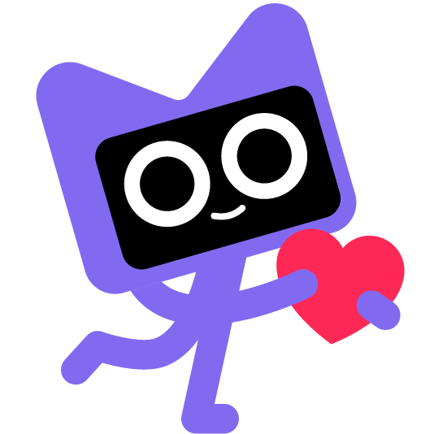

*Something something but the JVM is slow!!* [I don't give a damn](https://youtu.be/lhCPiauHI-g?t=103)

## But... console homebrew!! I want Undertale on my *insert console here*!!!

[Butterscotch already exists for that use case](https://github.com/ButterscotchRunner/Butterscotch).

If you want to see a what-if scenario, [here's what Starfait would look like if it was written in C](https://github.com/MrPowerGamerBR/StarfaitC).

## Why "Starfait"?

[Butterscotch](https://github.com/ButterscotchRunner/Butterscotch) was already taken, [Cinnamon](https://github.com/Project-Sunshine-Native/cinnamon) was already taken, so why not [Starfait](https://undertale.wiki/w/Starfait)?

## Acknowledgements

* [GameMaker-HTML5](https://github.com/YoYoGames/GameMaker-HTML5) - GameMaker's HTML5 runner, has references of how the runner logic works and has builtins implementations.
* [UndertaleModTool](https://github.com/UnderminersTeam/UndertaleModTool) - Very useful to check what Undertale's decompiled code looks like compared to what the bytecode looks like.
* [Ghidra](https://github.com/nationalsecurityagency/ghidra) - For decompiling the YoYo Runner's code for references.
* Toby Fox - For creating Undertale and DELTARUNE!

## Similar Projects

* [Butterscotch](https://github.com/ButterscotchRunner/Butterscotch)
* [UndertaleModTool](https://github.com/UnderminersTeam/UndertaleModTool)
* [OpenGM](https://github.com/misternebula/OpenGM)
* [reGML](https://github.com/TimGoTheCreator/reGML)
* [Luna](https://github.com/nommiin/Luna)
* [TinyGameMakerVM](https://github.com/MrPowerGamerBR/TinyGameMakerVM)
