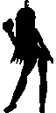
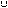
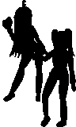
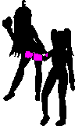

# Precise Collisions Masks

Collisions Masks can be rectangles, ellipses, diamonds, or pixel precise. Rectangles uses normal bounding boxes for the collisions, so we are going to focus on the other three.

When a collision mask is set, GameMaker generates a mask for you, stored in a special format alongside the sprite in the WAD file.

| Image                                   | Mask                                |
|-----------------------------------------|-------------------------------------|
|  |  |

The mask format is a byte array, where each byte stores 8 horizontal pixels of the image, sequentially, and each bit is a pixel.

If you have a 8x1 sprite alternating opaque and transparent pixels, the binary output of it would be `10101010`, where the 7th bit (the first bit from left to right) means that the pixel at (0, 0) is opaque, the 6th bit means that the pixel at (1, 0) is transparent, so on and so forth.

If you have a 8x2 sprite alternating opaque and transparent pixels, the binary output of it would be `1010101010101010`, your reader needs to know *when* to wrap the row of pixels!

Let's try decoding the mask of this 8x8 sprite: 

```kotlin
fun main() {
    val byteArray = File("spr_8x8.0.bin").readBytes()
    val width = 8

    var x = 0
    for (byte in byteArray) {
        if (x == width) {
            println()
            x = 0
        }

        repeat(8) {
            // The bit that we want to check is from left to right
            // So if we want to check the pixel at (0, 0), it would be the 7th bit
            val bitToCheck = 7 - it
            val isSet = (byte.toInt() and (1 shl bitToCheck)) != 0

            if (isSet) {
                print("1")
            } else {
                print(" ")
            }

            x++
        }
    }
}
```

We get the following result

```
00000000
01000010
01000010
01000010
00000000
01000010
00111100
00000000
```

And if we replace the `0` with ` ` so that it is easier for us to see...

```
        
 1    1 
 1    1 
 1    1 
        
 1    1 
  1111  
        
```

If your sprite is not divisible by 8, you must discard the remaining bits in the last row.

But now you are wondering: How would *that* help with collisions?

The mask is a list of pixels that are "solid" in the sprite, so you can figure out if two sprites are intersecting by asking each mask "is your pixel solid at this (worldX, worldY)?". If they are, then both sprites are overlapping!

| World                                     | Masks                                     | Collision                                 |
|-------------------------------------------|-------------------------------------------|-------------------------------------------|
|  |  |  |

On a *real* runner, you would only check the pixels where both sprites' bounding boxes overlap, and you would use a matrix to convert from the "world" coordinates into the "local" coordinates of the mask.

```kotlin
val x1 = MathUtils.delphiRound(spriteX).toFloat()
val y1 = MathUtils.delphiRound(spriteY).toFloat()

// A matrix that converts from the "world" location to the "sprite" local location, used to convert coordinates into local-sprite coordinates
// So essentially what we do is (remember that Matrix operations are backwards!):
// 1. We translate FROM the sprite's position in the world
// 2. We undo the rotation (we use "imageAngle" instead of "-imageAngle" because we already use "-imageAngle" when drawing the sprite)
// 3. We scale the image *down* based on the current scale, to convert the "world" size to the "sprite" size
// 4. We translate to the sprite's origin (in the sprite itself, NOT in the world)
// And that's all that there's to it!
this.matrix = Matrix3x2f()
    .translate(this.sprite.originX.toFloat(), this.sprite.originY.toFloat())
    .scale(1.0f / this.imageXScale, 1.0f / this.imageYScale)
    .rotate(Math.toRadians(imageAngle.toDouble()).toFloat())
    .translate(-x1, -y1)
```

And this is valid for other collision types too:

* Point -> Precise Mask collision? Just check if the point is set on the mask!
* Rectangle -> Precise Mask collision? Just check if the area of the rectangle is set on the mask!
* So on and so forth...