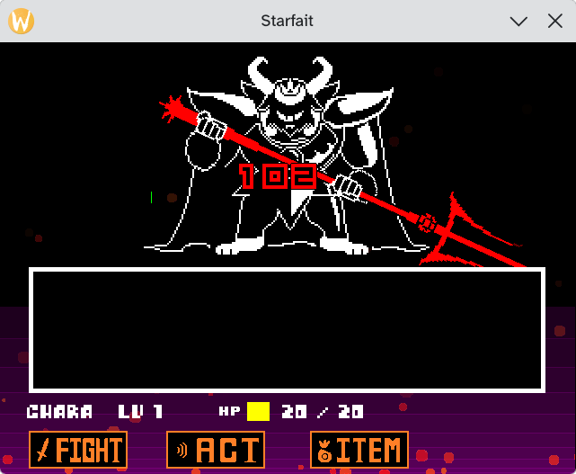
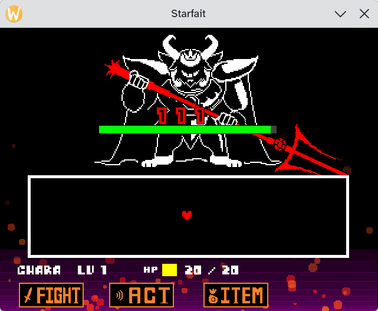

# Walking Through a Real Bug

When fighting Asgore, I've noticed that the damage bar was not being rendered correctly, it is so tiny!



To debug it, first I wanted to know... which object actually draws the damage bar?

For that, I used `--trace-function-calls draw_rectangle`

Then, when the damage bar is rendered, I paused the game with `P`, cleared the logs, then advanced one frame with `O`

```
VM: [gml_Script_ossafe_fill_rectangle] Calling function "draw_rectangle(Int32(value=-10), Real(value=478.77941549819894), Real(value=650.0), Real(value=480.0), Int32(value=0))"
VM: [gml_Script_ossafe_fill_rectangle] Called built-in function "draw_rectangle(Int32(value=-10), Real(value=478.77941549819894), Real(value=650.0), Real(value=480.0), Int32(value=0))"! Result: Undefined
VM: [gml_Script_ossafe_fill_rectangle] Calling function "draw_rectangle(Int32(value=-10), Real(value=475.1176619927957), Real(value=650.0), Real(value=478.77941549819894), Int32(value=0))"
VM: [gml_Script_ossafe_fill_rectangle] Called built-in function "draw_rectangle(Int32(value=-10), Real(value=475.1176619927957), Real(value=650.0), Real(value=478.77941549819894), Int32(value=0))"! Result: Undefined
VM: [gml_Script_ossafe_fill_rectangle] Calling function "draw_rectangle(Int32(value=-10), Real(value=469.0147394837903), Real(value=650.0), Real(value=475.1176619927957), Int32(value=0))"
VM: [gml_Script_ossafe_fill_rectangle] Called built-in function "draw_rectangle(Int32(value=-10), Real(value=469.0147394837903), Real(value=650.0), Real(value=475.1176619927957), Int32(value=0))"! Result: Undefined
VM: [gml_Script_ossafe_fill_rectangle] Calling function "draw_rectangle(Int32(value=-10), Real(value=460.4706479711828), Real(value=650.0), Real(value=469.0147394837903), Int32(value=0))"
VM: [gml_Script_ossafe_fill_rectangle] Called built-in function "draw_rectangle(Int32(value=-10), Real(value=460.4706479711828), Real(value=650.0), Real(value=469.0147394837903), Int32(value=0))"! Result: Undefined
VM: [gml_Script_ossafe_fill_rectangle] Calling function "draw_rectangle(Int32(value=-10), Real(value=449.48538745497314), Real(value=650.0), Real(value=460.4706479711828), Int32(value=0))"
VM: [gml_Script_ossafe_fill_rectangle] Called built-in function "draw_rectangle(Int32(value=-10), Real(value=449.48538745497314), Real(value=650.0), Real(value=460.4706479711828), Int32(value=0))"! Result: Undefined
VM: [gml_Script_ossafe_fill_rectangle] Calling function "draw_rectangle(Int32(value=-10), Real(value=436.05895793516135), Real(value=650.0), Real(value=449.48538745497314), Int32(value=0))"
VM: [gml_Script_ossafe_fill_rectangle] Called built-in function "draw_rectangle(Int32(value=-10), Real(value=436.05895793516135), Real(value=650.0), Real(value=449.48538745497314), Int32(value=0))"! Result: Undefined
VM: [gml_Script_ossafe_fill_rectangle] Calling function "draw_rectangle(Int32(value=-10), Real(value=420.1913594117474), Real(value=650.0), Real(value=436.05895793516135), Int32(value=0))"
VM: [gml_Script_ossafe_fill_rectangle] Called built-in function "draw_rectangle(Int32(value=-10), Real(value=420.1913594117474), Real(value=650.0), Real(value=436.05895793516135), Int32(value=0))"! Result: Undefined
VM: [gml_Script_ossafe_fill_rectangle] Calling function "draw_rectangle(Int32(value=-10), Real(value=401.88259188473126), Real(value=650.0), Real(value=420.1913594117474), Int32(value=0))"
VM: [gml_Script_ossafe_fill_rectangle] Called built-in function "draw_rectangle(Int32(value=-10), Real(value=401.88259188473126), Real(value=650.0), Real(value=420.1913594117474), Int32(value=0))"! Result: Undefined
VM: [gml_Script_ossafe_fill_rectangle] Calling function "draw_rectangle(Int32(value=-10), Real(value=381.132655354113), Real(value=650.0), Real(value=401.88259188473126), Int32(value=0))"
VM: [gml_Script_ossafe_fill_rectangle] Called built-in function "draw_rectangle(Int32(value=-10), Real(value=381.132655354113), Real(value=650.0), Real(value=401.88259188473126), Int32(value=0))"! Result: Undefined
VM: [gml_Script_ossafe_fill_rectangle] Calling function "draw_rectangle(Int32(value=-10), Real(value=357.9415498198926), Real(value=650.0), Real(value=381.132655354113), Int32(value=0))"
VM: [gml_Script_ossafe_fill_rectangle] Called built-in function "draw_rectangle(Int32(value=-10), Real(value=357.9415498198926), Real(value=650.0), Real(value=381.132655354113), Int32(value=0))"! Result: Undefined
VM: [gml_Script_ossafe_fill_rectangle] Calling function "draw_rectangle(Real(value=37.0), Real(value=255.0), Real(value=602.0), Real(value=385.0), Int32(value=0))"
VM: [gml_Script_ossafe_fill_rectangle] Called built-in function "draw_rectangle(Real(value=37.0), Real(value=255.0), Real(value=602.0), Real(value=385.0), Int32(value=0))"! Result: Undefined
VM: [gml_Script_ossafe_fill_rectangle] Calling function "draw_rectangle(Int32(value=275), Int32(value=400), Real(value=299.0), Int32(value=420), Int32(value=0))"
VM: [gml_Script_ossafe_fill_rectangle] Called built-in function "draw_rectangle(Int32(value=275), Int32(value=400), Real(value=299.0), Int32(value=420), Int32(value=0))"! Result: Undefined
VM: [gml_Script_ossafe_fill_rectangle] Calling function "draw_rectangle(Int32(value=275), Int32(value=400), Real(value=299.0), Int32(value=420), Int32(value=0))"
VM: [gml_Script_ossafe_fill_rectangle] Called built-in function "draw_rectangle(Int32(value=275), Int32(value=400), Real(value=299.0), Int32(value=420), Int32(value=0))"! Result: Undefined
VM: [gml_Script_ossafe_fill_rectangle] Calling function "draw_rectangle(Real(value=167.0), Real(value=165.0), Real(value=169.0), Real(value=179.0), Int32(value=0))"
VM: [gml_Script_ossafe_fill_rectangle] Called built-in function "draw_rectangle(Real(value=167.0), Real(value=165.0), Real(value=169.0), Real(value=179.0), Int32(value=0))"! Result: Undefined
VM: [gml_Script_ossafe_fill_rectangle] Calling function "draw_rectangle(Real(value=168.0), Real(value=166.0), Real(value=168.0), Real(value=178.0), Int32(value=0))"
VM: [gml_Script_ossafe_fill_rectangle] Called built-in function "draw_rectangle(Real(value=168.0), Real(value=166.0), Real(value=168.0), Real(value=178.0), Int32(value=0))"! Result: Undefined
VM: [gml_Script_ossafe_fill_rectangle] Calling function "draw_rectangle(Real(value=168.0), Real(value=166.0), Real(value=168.0), Real(value=178.0), Int32(value=0))"
VM: [gml_Script_ossafe_fill_rectangle] Called built-in function "draw_rectangle(Real(value=168.0), Real(value=166.0), Real(value=168.0), Real(value=178.0), Int32(value=0))"! Result: Undefined
```

Welp, that doesn't help because Undertale uses a `gml_Script_ossafe_fill_rectangle` script instead of calling `draw_rectangle` directly¹, so we need to also track who is calling the `draw_rectangle` call!

To do that, we'll update our `--trace-function-calls` to be `--trace-function-calls draw_rectangle,ossafe_fill_rectangle` and do the same thing again

```
VM: [gml_Object_obj_purplegradienter_Draw_0] Calling function "ossafe_fill_rectangle(Int32(value=-10), Real(value=480.0), Real(value=650.0), Real(value=478.4924808813657))"
VM: [gml_Script_ossafe_fill_rectangle] Calling function "draw_rectangle(Int32(value=-10), Real(value=478.4924808813657), Real(value=650.0), Real(value=480.0), Int32(value=0))"
VM: [gml_Script_ossafe_fill_rectangle] Called built-in function "draw_rectangle(Int32(value=-10), Real(value=478.4924808813657), Real(value=650.0), Real(value=480.0), Int32(value=0))"! Result: Undefined
VM: [gml_Object_obj_purplegradienter_Draw_0] Called script function "ossafe_fill_rectangle(Int32(value=-10), Real(value=480.0), Real(value=650.0), Real(value=478.4924808813657))"! Result: undefined
VM: [gml_Object_obj_purplegradienter_Draw_0] Calling function "ossafe_fill_rectangle(Int32(value=-10), Real(value=478.4924808813657), Real(value=650.0), Real(value=473.9699235254626))"
VM: [gml_Script_ossafe_fill_rectangle] Calling function "draw_rectangle(Int32(value=-10), Real(value=473.9699235254626), Real(value=650.0), Real(value=478.4924808813657), Int32(value=0))"
VM: [gml_Script_ossafe_fill_rectangle] Called built-in function "draw_rectangle(Int32(value=-10), Real(value=473.9699235254626), Real(value=650.0), Real(value=478.4924808813657), Int32(value=0))"! Result: Undefined
VM: [gml_Object_obj_purplegradienter_Draw_0] Called script function "ossafe_fill_rectangle(Int32(value=-10), Real(value=478.4924808813657), Real(value=650.0), Real(value=473.9699235254626))"! Result: undefined
VM: [gml_Object_obj_purplegradienter_Draw_0] Calling function "ossafe_fill_rectangle(Int32(value=-10), Real(value=473.9699235254626), Real(value=650.0), Real(value=466.43232793229095))"
VM: [gml_Script_ossafe_fill_rectangle] Calling function "draw_rectangle(Int32(value=-10), Real(value=466.43232793229095), Real(value=650.0), Real(value=473.9699235254626), Int32(value=0))"
VM: [gml_Script_ossafe_fill_rectangle] Called built-in function "draw_rectangle(Int32(value=-10), Real(value=466.43232793229095), Real(value=650.0), Real(value=473.9699235254626), Int32(value=0))"! Result: Undefined
VM: [gml_Object_obj_purplegradienter_Draw_0] Called script function "ossafe_fill_rectangle(Int32(value=-10), Real(value=473.9699235254626), Real(value=650.0), Real(value=466.43232793229095))"! Result: undefined
VM: [gml_Object_obj_purplegradienter_Draw_0] Calling function "ossafe_fill_rectangle(Int32(value=-10), Real(value=466.43232793229095), Real(value=650.0), Real(value=455.87969410185053))"
VM: [gml_Script_ossafe_fill_rectangle] Calling function "draw_rectangle(Int32(value=-10), Real(value=455.87969410185053), Real(value=650.0), Real(value=466.43232793229095), Int32(value=0))"
VM: [gml_Script_ossafe_fill_rectangle] Called built-in function "draw_rectangle(Int32(value=-10), Real(value=455.87969410185053), Real(value=650.0), Real(value=466.43232793229095), Int32(value=0))"! Result: Undefined
VM: [gml_Object_obj_purplegradienter_Draw_0] Called script function "ossafe_fill_rectangle(Int32(value=-10), Real(value=466.43232793229095), Real(value=650.0), Real(value=455.87969410185053))"! Result: undefined
VM: [gml_Object_obj_purplegradienter_Draw_0] Calling function "ossafe_fill_rectangle(Int32(value=-10), Real(value=455.87969410185053), Real(value=650.0), Real(value=442.3120220341414))"
VM: [gml_Script_ossafe_fill_rectangle] Calling function "draw_rectangle(Int32(value=-10), Real(value=442.3120220341414), Real(value=650.0), Real(value=455.87969410185053), Int32(value=0))"
VM: [gml_Script_ossafe_fill_rectangle] Called built-in function "draw_rectangle(Int32(value=-10), Real(value=442.3120220341414), Real(value=650.0), Real(value=455.87969410185053), Int32(value=0))"! Result: Undefined
VM: [gml_Object_obj_purplegradienter_Draw_0] Called script function "ossafe_fill_rectangle(Int32(value=-10), Real(value=455.87969410185053), Real(value=650.0), Real(value=442.3120220341414))"! Result: undefined
VM: [gml_Object_obj_purplegradienter_Draw_0] Calling function "ossafe_fill_rectangle(Int32(value=-10), Real(value=442.3120220341414), Real(value=650.0), Real(value=425.72931172916367))"
VM: [gml_Script_ossafe_fill_rectangle] Calling function "draw_rectangle(Int32(value=-10), Real(value=425.72931172916367), Real(value=650.0), Real(value=442.3120220341414), Int32(value=0))"
VM: [gml_Script_ossafe_fill_rectangle] Called built-in function "draw_rectangle(Int32(value=-10), Real(value=425.72931172916367), Real(value=650.0), Real(value=442.3120220341414), Int32(value=0))"! Result: Undefined
VM: [gml_Object_obj_purplegradienter_Draw_0] Called script function "ossafe_fill_rectangle(Int32(value=-10), Real(value=442.3120220341414), Real(value=650.0), Real(value=425.72931172916367))"! Result: undefined
VM: [gml_Object_obj_purplegradienter_Draw_0] Calling function "ossafe_fill_rectangle(Int32(value=-10), Real(value=425.72931172916367), Real(value=650.0), Real(value=406.1315631869172))"
VM: [gml_Script_ossafe_fill_rectangle] Calling function "draw_rectangle(Int32(value=-10), Real(value=406.1315631869172), Real(value=650.0), Real(value=425.72931172916367), Int32(value=0))"
VM: [gml_Script_ossafe_fill_rectangle] Called built-in function "draw_rectangle(Int32(value=-10), Real(value=406.1315631869172), Real(value=650.0), Real(value=425.72931172916367), Int32(value=0))"! Result: Undefined
VM: [gml_Object_obj_purplegradienter_Draw_0] Called script function "ossafe_fill_rectangle(Int32(value=-10), Real(value=425.72931172916367), Real(value=650.0), Real(value=406.1315631869172))"! Result: undefined
VM: [gml_Object_obj_purplegradienter_Draw_0] Calling function "ossafe_fill_rectangle(Int32(value=-10), Real(value=406.1315631869172), Real(value=650.0), Real(value=383.5187764074021))"
VM: [gml_Script_ossafe_fill_rectangle] Calling function "draw_rectangle(Int32(value=-10), Real(value=383.5187764074021), Real(value=650.0), Real(value=406.1315631869172), Int32(value=0))"
VM: [gml_Script_ossafe_fill_rectangle] Called built-in function "draw_rectangle(Int32(value=-10), Real(value=383.5187764074021), Real(value=650.0), Real(value=406.1315631869172), Int32(value=0))"! Result: Undefined
VM: [gml_Object_obj_purplegradienter_Draw_0] Called script function "ossafe_fill_rectangle(Int32(value=-10), Real(value=406.1315631869172), Real(value=650.0), Real(value=383.5187764074021))"! Result: undefined
VM: [gml_Object_obj_purplegradienter_Draw_0] Calling function "ossafe_fill_rectangle(Int32(value=-10), Real(value=383.5187764074021), Real(value=650.0), Real(value=357.8909513906183))"
VM: [gml_Script_ossafe_fill_rectangle] Calling function "draw_rectangle(Int32(value=-10), Real(value=357.8909513906183), Real(value=650.0), Real(value=383.5187764074021), Int32(value=0))"
VM: [gml_Script_ossafe_fill_rectangle] Called built-in function "draw_rectangle(Int32(value=-10), Real(value=357.8909513906183), Real(value=650.0), Real(value=383.5187764074021), Int32(value=0))"! Result: Undefined
VM: [gml_Object_obj_purplegradienter_Draw_0] Called script function "ossafe_fill_rectangle(Int32(value=-10), Real(value=383.5187764074021), Real(value=650.0), Real(value=357.8909513906183))"! Result: undefined
VM: [gml_Object_obj_purplegradienter_Draw_0] Calling function "ossafe_fill_rectangle(Int32(value=-10), Real(value=357.8909513906183), Real(value=650.0), Real(value=329.2480881365658))"
VM: [gml_Script_ossafe_fill_rectangle] Calling function "draw_rectangle(Int32(value=-10), Real(value=329.2480881365658), Real(value=650.0), Real(value=357.8909513906183), Int32(value=0))"
VM: [gml_Script_ossafe_fill_rectangle] Called built-in function "draw_rectangle(Int32(value=-10), Real(value=329.2480881365658), Real(value=650.0), Real(value=357.8909513906183), Int32(value=0))"! Result: Undefined
VM: [gml_Object_obj_purplegradienter_Draw_0] Called script function "ossafe_fill_rectangle(Int32(value=-10), Real(value=357.8909513906183), Real(value=650.0), Real(value=329.2480881365658))"! Result: undefined
VM: [gml_Object_obj_battlecontroller_Draw_0] Calling function "ossafe_fill_rectangle(Real(value=37.0), Real(value=255.0), Real(value=602.0), Real(value=385.0))"
VM: [gml_Script_ossafe_fill_rectangle] Calling function "draw_rectangle(Real(value=37.0), Real(value=255.0), Real(value=602.0), Real(value=385.0), Int32(value=0))"
VM: [gml_Script_ossafe_fill_rectangle] Called built-in function "draw_rectangle(Real(value=37.0), Real(value=255.0), Real(value=602.0), Real(value=385.0), Int32(value=0))"! Result: Undefined
VM: [gml_Object_obj_battlecontroller_Draw_0] Called script function "ossafe_fill_rectangle(Real(value=37.0), Real(value=255.0), Real(value=602.0), Real(value=385.0))"! Result: undefined
VM: [gml_Script_scr_binfowrite] Calling function "ossafe_fill_rectangle(Int32(value=275), Int32(value=400), Real(value=299.0), Int32(value=420))"
VM: [gml_Script_ossafe_fill_rectangle] Calling function "draw_rectangle(Int32(value=275), Int32(value=400), Real(value=299.0), Int32(value=420), Int32(value=0))"
VM: [gml_Script_ossafe_fill_rectangle] Called built-in function "draw_rectangle(Int32(value=275), Int32(value=400), Real(value=299.0), Int32(value=420), Int32(value=0))"! Result: Undefined
VM: [gml_Script_scr_binfowrite] Called script function "ossafe_fill_rectangle(Int32(value=275), Int32(value=400), Real(value=299.0), Int32(value=420))"! Result: undefined
VM: [gml_Script_scr_binfowrite] Calling function "ossafe_fill_rectangle(Int32(value=275), Int32(value=400), Real(value=299.0), Int32(value=420))"
VM: [gml_Script_ossafe_fill_rectangle] Calling function "draw_rectangle(Int32(value=275), Int32(value=400), Real(value=299.0), Int32(value=420), Int32(value=0))"
VM: [gml_Script_ossafe_fill_rectangle] Called built-in function "draw_rectangle(Int32(value=275), Int32(value=400), Real(value=299.0), Int32(value=420), Int32(value=0))"! Result: Undefined
VM: [gml_Script_scr_binfowrite] Called script function "ossafe_fill_rectangle(Int32(value=275), Int32(value=400), Real(value=299.0), Int32(value=420))"! Result: undefined
VM: [gml_Object_obj_dmgwriter_Draw_0] Calling function "ossafe_fill_rectangle(Real(value=167.0), Real(value=165.0), Real(value=169.0), Real(value=179.0))"
VM: [gml_Script_ossafe_fill_rectangle] Calling function "draw_rectangle(Real(value=167.0), Real(value=165.0), Real(value=169.0), Real(value=179.0), Int32(value=0))"
VM: [gml_Script_ossafe_fill_rectangle] Called built-in function "draw_rectangle(Real(value=167.0), Real(value=165.0), Real(value=169.0), Real(value=179.0), Int32(value=0))"! Result: Undefined
VM: [gml_Object_obj_dmgwriter_Draw_0] Called script function "ossafe_fill_rectangle(Real(value=167.0), Real(value=165.0), Real(value=169.0), Real(value=179.0))"! Result: undefined
VM: [gml_Object_obj_dmgwriter_Draw_0] Calling function "ossafe_fill_rectangle(Real(value=168.0), Real(value=166.0), Real(value=168.0), Real(value=178.0))"
VM: [gml_Script_ossafe_fill_rectangle] Calling function "draw_rectangle(Real(value=168.0), Real(value=166.0), Real(value=168.0), Real(value=178.0), Int32(value=0))"
VM: [gml_Script_ossafe_fill_rectangle] Called built-in function "draw_rectangle(Real(value=168.0), Real(value=166.0), Real(value=168.0), Real(value=178.0), Int32(value=0))"! Result: Undefined
VM: [gml_Object_obj_dmgwriter_Draw_0] Called script function "ossafe_fill_rectangle(Real(value=168.0), Real(value=166.0), Real(value=168.0), Real(value=178.0))"! Result: undefined
VM: [gml_Object_obj_dmgwriter_Draw_0] Calling function "ossafe_fill_rectangle(Real(value=168.0), Real(value=166.0), Real(value=168.0), Real(value=178.0))"
VM: [gml_Script_ossafe_fill_rectangle] Calling function "draw_rectangle(Real(value=168.0), Real(value=166.0), Real(value=168.0), Real(value=178.0), Int32(value=0))"
VM: [gml_Script_ossafe_fill_rectangle] Called built-in function "draw_rectangle(Real(value=168.0), Real(value=166.0), Real(value=168.0), Real(value=178.0), Int32(value=0))"! Result: Undefined
VM: [gml_Object_obj_dmgwriter_Draw_0] Called script function "ossafe_fill_rectangle(Real(value=168.0), Real(value=166.0), Real(value=168.0), Real(value=178.0))"! Result: undefined
```

Now we are talking! We know that these are all the callers of `ossafe_fill_rectangle` while the damage rectangle is drawn

* `gml_Object_obj_purplegradienter_Draw_0`
* `gml_Object_obj_battlecontroller_Draw_0`
* `gml_Script_scr_binfowrite`
* `gml_Object_obj_dmgwriter_Draw_0`

We can already rule out `gml_Object_obj_purplegradienter_Draw_0` because by its name we already know it is the background effect, but the rest it is better for us to look at the decompiled game code output via [UndertaleModTool](https://github.com/UnderminersTeam/UndertaleModTool). By looking at the code game's code, the `gml_Script_scr_binfowrite` (which is not `bin fo write` but actually `battle info write`) is used to render the player's informations (like the LV and the health), while `gml_Object_obj_battlecontroller_Draw_0` is used to render the monster's health on the Fight menu.

So that leaves us with `gml_Object_obj_dmgwriter_Draw_0`, and by looking at the code it surely looks like it draws the damage rectangle.

```gml
    if (drawbar == 1)
    {
        draw_set_color(c_black);
        ossafe_fill_rectangle(x - 1, ystart + 7, x + round((global.monstermaxhp[global.mytarget] * stretchfactor) + 1), ystart + 21);
        draw_set_color(c_dkgray);
        ossafe_fill_rectangle(x, ystart + 8, x + round(global.monstermaxhp[global.mytarget] * stretchfactor), ystart + 20);
        draw_set_color(c_lime);
        if (apparenthp > 0)
        {
            ossafe_fill_rectangle(x, ystart + 8, round(x + (apparenthp * stretchfactor)), ystart + 20);
        }
    }
```

So we know that the value is multiplied by the `stretchfactor`... is that value set to a reasonable value? To do that, we use `F11` to dump the current runner state as a JSON, which includes all the variables.

```json
                    "stretchfactor": {
                        "type": "Real",
                        "value": 0.0
                    },
```

Oh... so it is 0 for some reason? Who sets the `stretchfactor` in the code?

```gml
stretchwidth = global.monsterinstance[global.mytarget].wd;
stretchfactor = stretchwidth / global.monstermaxhp[global.mytarget];
```

What is the `stretchwidth`?

```json
                    "stretchwidth": {
                        "type": "Int32",
                        "value": 300
                    },
```

And what is the `global.monstermaxhp[global.mytarget]`?

```json
            "mytarget": {
              "type": "Int32",
              "value": 0
            },
        ...
            "monstermaxhp": {
                "type": "Array",
                "value": {
                    "0": {
                        "type": "Int32",
                        "value": 3500
                    },
                    "1": {
                        "type": "Int32",
                        "value": 50
                    },
                    "2": {
                        "type": "Int32",
                        "value": 50
                    }
                }
            },
```

So we know that the `stretchfactor` should be set to `300 / 3500 = 0.08571428571`... so why it is 0?

Let's trace the instructions that the `gml_Object_obj_dmgwriter_Create_0` script is executing, we can do that by using `--trace-opcodes gml_Object_obj_dmgwriter_Create_0`.

```
VM: [gml_Object_obj_dmgwriter_Create_0] (2197096) [0x840ffffb] PUSH_IMMEDIATE (type1: 0000000f (INT16), type2: 00000000 (DOUBLE), extra: fffffffb) [stack=0 []]
VM: [gml_Object_obj_dmgwriter_Create_0] (2197100) [0xc205fffb] PUSH_GLOBAL (type1: 00000005 (VARIABLE), type2: 00000000 (DOUBLE), extra: fffffffb) [stack=1 [int32(-5)]]
VM: [gml_Object_obj_dmgwriter_Create_0] (2197108) [0x07250000] CONV (type1: 00000005 (VARIABLE), type2: 00000002 (INT32), extra: 00000000) [stack=2 [int32(-5), variable(int32(0))]]
VM: [gml_Object_obj_dmgwriter_Create_0] (2197112) [0xc0050000] PUSH (type1: 00000005 (VARIABLE), type2: 00000000 (DOUBLE), extra: 00000000) [stack=2 [int32(-5), int32(0)]]
VM: [gml_Object_obj_dmgwriter_Create_0] (2197120) [0x07250000] CONV (type1: 00000005 (VARIABLE), type2: 00000002 (INT32), extra: 00000000) [stack=1 [variable(real(114131.0))]]
VM: [gml_Object_obj_dmgwriter_Create_0] (2197124) [0xc0050000] PUSH (type1: 00000005 (VARIABLE), type2: 00000000 (DOUBLE), extra: 00000000) [stack=1 [int32(114131)]]
VM: [gml_Object_obj_dmgwriter_Create_0] (2197132) [0x4555ffff] POP (type1: 00000005 (VARIABLE), type2: 00000005 (VARIABLE), extra: ffffffff) [stack=1 [variable(int32(300))]]
VM: [gml_Object_obj_dmgwriter_Create_0] (2197140) [0xc005ffff] PUSH (type1: 00000005 (VARIABLE), type2: 00000000 (DOUBLE), extra: ffffffff) [stack=0 []]
VM: [gml_Object_obj_dmgwriter_Create_0] (2197148) [0x840ffffb] PUSH_IMMEDIATE (type1: 0000000f (INT16), type2: 00000000 (DOUBLE), extra: fffffffb) [stack=1 [variable(int32(300))]]
VM: [gml_Object_obj_dmgwriter_Create_0] (2197152) [0xc205fffb] PUSH_GLOBAL (type1: 00000005 (VARIABLE), type2: 00000000 (DOUBLE), extra: fffffffb) [stack=2 [variable(int32(300)), int32(-5)]]
VM: [gml_Object_obj_dmgwriter_Create_0] (2197160) [0x07250000] CONV (type1: 00000005 (VARIABLE), type2: 00000002 (INT32), extra: 00000000) [stack=3 [variable(int32(300)), int32(-5), variable(int32(0))]]
VM: [gml_Object_obj_dmgwriter_Create_0] (2197164) [0xc0050000] PUSH (type1: 00000005 (VARIABLE), type2: 00000000 (DOUBLE), extra: 00000000) [stack=3 [variable(int32(300)), int32(-5), int32(0)]]
VM: [gml_Object_obj_dmgwriter_Create_0] (2197172) [0x09550000] DIV (type1: 00000005 (VARIABLE), type2: 00000005 (VARIABLE), extra: 00000000) [stack=2 [variable(int32(300)), variable(int32(3500))]]
VM: [gml_Object_obj_dmgwriter_Create_0] (2197176) [0x4555ffff] POP (type1: 00000005 (VARIABLE), type2: 00000005 (VARIABLE), extra: ffffffff) [stack=1 [variable(real(0.0))]]
```

Okay, so we *know* that it is pushing the right values of both variables to the stack (`[stack=2 [variable(int32(300)), variable(int32(3500))]]`) but the pushed result is `0.0`.

If we try doing that division in GameMaker: Studio 1.4.9999, what value does it gives us?

```gml
self.value1 = 300.0;
self.value2 = 3500.0;
show_debug_message(string(self.value1 / self.value2));
```

```
0.09
```

Oh, okay, so given this we can assume that any arithmetic operation in variables is converted to a real.

So, after changing this

```kotlin
    fun arithmeticType() = when (this) {
        is Boolean -> ArithmeticType.REAL
        is Double -> ArithmeticType.REAL
        is Int32 -> ArithmeticType.INT32
        is Int64 -> ArithmeticType.INT64
        is String -> ArithmeticType.STRING
        is Variable -> when (val value = this.value) {
            is RValue.Int32 -> ArithmeticType.INT32
            is RValue.Int64 -> ArithmeticType.INT64
            is RValue.Real -> ArithmeticType.REAL
            is RValue.String -> ArithmeticType.STRING
            else -> error("Type $value does not support arithmetic!")
        }
    }
```

To this (so that all variable types are recognized as a real instead of their "correct" type)...

```kotlin
    fun arithmeticType() = when (this) {
        is Boolean -> ArithmeticType.REAL
        is Double -> ArithmeticType.REAL
        is Int32 -> ArithmeticType.INT32
        is Int64 -> ArithmeticType.INT64
        is String -> ArithmeticType.STRING
        is Variable -> when (val value = this.value) {
            is RValue.Int32 -> ArithmeticType.REAL
            is RValue.Int64 -> ArithmeticType.REAL
            is RValue.Real -> ArithmeticType.REAL
            is RValue.String -> ArithmeticType.STRING
            else -> error("Type $value does not support arithmetic!")
        }
    }
```

The bug is now fixed!



¹ The reason why Undertale does that is because "Please note that the rectangle being drawn may need different values (+/-1 on the x, y, or width or height) to be drawn with the desired dimensions due to differences across the various supported platforms."... thanks YoYo Games!